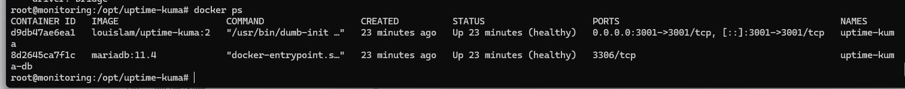

import pypandoc, os

md = r'''# Installation d'Uptime Kuma 2 avec MariaDB — Procédure pas à pas

**VM :** `monitoring`  
**Système :** Ubuntu 26.04.1 LTS    
**Répertoire :** `/opt/uptime-kuma`  
**Fichier Docker Compose utilisé :** `compose.yaml`

> Ce document décrit uniquement l'installation avec le fichier Compose actuel : un conteneur Uptime Kuma et un conteneur MariaDB. Il ne décrit pas l'ancienne installation Uptime Kuma seule avec SQLite.

---

## 1. Résultat attendu

À la fin de la procédure, les deux conteneurs doivent fonctionner :

| Conteneur | Fonction | État attendu |
|---|---|---|
| `uptime-kuma` | Application de monitoring | `Up` / `healthy` |
| `uptime-kuma-db` | Base MariaDB | `Up (healthy)` |

L'interface sera accessible à l'adresse :

```text
http://IP:3001
```

MariaDB ne sera pas publiée directement sur le réseau de la VM. Uptime Kuma y accédera par le réseau Docker privé avec le nom d'hôte `db`.

## 2. Vérifier les prérequis

Se connecter à la VM puis exécuter :

```bash
hostnamectl
ip -br a
df -h
docker --version
docker compose version
```

Vérifier que le port 3001 n'est pas déjà utilisé par un autre service :

```bash
ss -lntp | grep ':3001' || true
```

Vérifier les conteneurs existants :

```bash
docker ps -a
```

Docker Engine et Docker Compose doivent être installés et fonctionnels avant de continuer.

## 3. Vérifier le répertoire de travail

```bash
cd /opt/uptime-kuma
pwd
ls -lah
```

Le répertoire peut contenir :

```text
/opt/uptime-kuma/
├── compose.yaml
├── .env
└── data/
```

Vérifier les services définis dans le fichier actif :

```bash
docker compose -f compose.yaml config --services
```

Résultat attendu :

```text
db
uptime-kuma
```

## 4. Créer ou vérifier les mots de passe MariaDB

Le fichier Compose utilise deux variables provenant du fichier `.env` :

- `MARIADB_ROOT_PASSWORD`
- `KUMA_DB_PASSWORD`

Si les secrets ne sont pas encore créés, générer deux valeurs distinctes :

```bash
openssl rand -hex 32
openssl rand -hex 32
```

Créer le fichier `.env` :

```bash
cd /opt/uptime-kuma
nano .env
```

Contenu :

```dotenv
MARIADB_ROOT_PASSWORD=REMPLACER_PAR_LE_SECRET_ROOT
KUMA_DB_PASSWORD=REMPLACER_PAR_LE_SECRET_KUMA
```

Remplacer les deux valeurs par les secrets générés, puis protéger le fichier :

```bash
chmod 600 .env
```

Ne pas publier le contenu de `.env` et ne pas envoyer les mots de passe dans une capture d'écran.

Si un fichier `.env` existe déjà et contient les deux variables correctes, ne pas le remplacer inutilement.

## 5. Vérifier le fichier compose.yaml

Le fichier `/opt/uptime-kuma/compose.yaml` doit contenir :

```yaml
services:
  db:
    image: mariadb:11.4
    container_name: uptime-kuma-db
    restart: unless-stopped
    environment:
      MARIADB_ROOT_PASSWORD: ${MARIADB_ROOT_PASSWORD}
      MARIADB_DATABASE: uptimekuma
      MARIADB_USER: kuma
      MARIADB_PASSWORD: ${KUMA_DB_PASSWORD}
    volumes:
      - kuma-db-data:/var/lib/mysql
    networks:
      - kuma-network
    healthcheck:
      test: ["CMD", "healthcheck.sh", "--connect", "--innodb_initialized"]
      interval: 10s
      timeout: 5s
      retries: 10
      start_period: 30s

  uptime-kuma:
    image: louislam/uptime-kuma:2
    container_name: uptime-kuma
    restart: unless-stopped
    ports:
      - "3001:3001"
    volumes:
      - uptime-kuma-data:/app/data
    networks:
      - kuma-network
    depends_on:
      db:
        condition: service_healthy

volumes:
  uptime-kuma-data:
    name: uptime-kuma_uptime-kuma-data
  kuma-db-data:
    name: uptime-kuma_mariadb-data

networks:
  kuma-network:
    driver: bridge
```

Ce fichier correspond à la configuration demandée. La sélection et les paramètres de la base MariaDB seront renseignés dans l'assistant Web Uptime Kuma.

## 6. Valider la configuration Compose

Depuis `/opt/uptime-kuma` :

```bash
docker compose -f compose.yaml config -q
```

Si aucune erreur n'est affichée, la syntaxe YAML et l'interpolation des variables sont valides.

Afficher les services :

```bash
docker compose -f compose.yaml config --services
```

Résultat attendu :

```text
db
uptime-kuma
```

Si Docker affiche un avertissement indiquant plusieurs fichiers Compose, continuer à utiliser explicitement `-f compose.yaml` et vérifier qu'aucun autre fichier actif n'est utilisé.

## 7. Démarrer les conteneurs

```bash
cd /opt/uptime-kuma
docker compose -f compose.yaml up -d
```

Afficher leur état :

```bash
docker compose -f compose.yaml ps
```

Le premier démarrage de MariaDB peut prendre un peu de temps pendant l'initialisation de la base. Attendre que son état soit `healthy`.

Afficher également les conteneurs :

```bash
docker ps
```

Résultat attendu : deux conteneurs, `uptime-kuma` et `uptime-kuma-db`.

## 8. Contrôler les journaux

Journaux MariaDB :

```bash
docker logs uptime-kuma-db --tail 50
```

Journaux Uptime Kuma :

```bash
docker logs uptime-kuma --tail 50
```

Ou avec Compose :

```bash
docker compose -f compose.yaml logs --tail=50
```

Si MariaDB ne démarre pas, examiner son journal avant de poursuivre.

## 9. Vérifier que MariaDB fonctionne

Vérifier le healthcheck :

```bash
docker inspect --format='{{.State.Health.Status}}' uptime-kuma-db
```

Résultat attendu :

```text
healthy
```

Tester la connexion avec l'utilisateur applicatif :

```bash
docker exec -it uptime-kuma-db mariadb -u kuma -p uptimekuma
```

Saisir le mot de passe défini par `KUMA_DB_PASSWORD` dans `.env`.

Dans MariaDB, exécuter :

```sql
SELECT VERSION();
SELECT DATABASE();
EXIT;
```

Cette vérification confirme que la base `uptimekuma` et l'utilisateur `kuma` sont accessibles.

## 10. Configurer Uptime Kuma depuis le navigateur

Ouvrir :

```text
http://IP:3001
```

Dans l'écran initial :

1. Choisir la langue.
2. Sélectionner **MariaDB/MySQL**.
3. Cliquer sur **Next**.
4. Renseigner les paramètres suivants :

| Champ de l'assistant | Valeur |
|---|---|
| Hostname | `db` |
| Port | `3306` |
| Database | Valeur de  `KUMA_DB_NAME` dans .env|
| Username | Valeur de `KUMA_DB_USER` dans .env |
| Password | Valeur de `KUMA_DB_PASSWORD` dans `.env` |

**Pourquoi `db` ?** C'est le nom du service MariaDB dans `compose.yaml`. Les deux conteneurs partagent le réseau Docker `kuma-network`; ils peuvent donc se joindre par ce nom.

Ne pas saisir `localhost` ou `127.0.0.1` comme hostname : depuis le conteneur Uptime Kuma, ces adresses désignent le conteneur Uptime Kuma lui-même, pas MariaDB.

Valider la configuration, puis créer le compte administrateur si l'assistant le demande.

## 11. Vérification finale

Exécuter :

```bash
cd /opt/uptime-kuma
docker compose -f compose.yaml ps
```

Vérifier que :

- `uptime-kuma-db` est `healthy`.
- `uptime-kuma` est démarré.
- L'interface Web s'ouvre.
- L'assistant de configuration est terminé.
- La connexion à MariaDB ne produit pas d'erreur dans les journaux.

Tester l'interface depuis la VM :

```bash
curl -I http://127.0.0.1:3001
```

Pour vérifier les tables créées par Uptime Kuma après la configuration initiale :

```bash
docker exec -it uptime-kuma-db mariadb -u kuma -p uptimekuma
```

Puis :

```sql
SHOW TABLES;
EXIT;
```

Des tables de l'application doivent être visibles après l'initialisation réussie.

## 12. Commandes utiles

```bash
cd /opt/uptime-kuma

# État des conteneurs
docker compose -f compose.yaml ps

# Journaux de tous les services
docker compose -f compose.yaml logs --tail=100

# Journaux MariaDB
docker compose -f compose.yaml logs --tail=100 db

# Journaux Uptime Kuma
docker compose -f compose.yaml logs --tail=100 uptime-kuma

# Redémarrer les conteneurs
docker compose -f compose.yaml restart

# Démarrer ou recréer selon la configuration
docker compose -f compose.yaml up -d

# Arrêter les conteneurs sans supprimer les volumes
docker compose -f compose.yaml down
```

**Ne pas exécuter `docker compose down -v`** : l'option `-v` supprime les volumes et peut effacer les données persistantes de l'application et de MariaDB.

## 13. Sécurité minimale

- Autoriser le port TCP 3001 uniquement depuis le réseau d'administration.
- Ne pas publier le port MariaDB 3306 sur l'hôte.
- Conserver `.env` avec les permissions `600`.
- Utiliser un mot de passe administrateur fort.
- Ne pas exposer directement l'interface Uptime Kuma sur Internet.
- Prévoir des sauvegardes de la base MariaDB et des données de l'application sur un stockage distinct.


Vérifier les règles existantes avant toute modification du firewall afin de ne pas perdre l'accès SSH.

---

## Arbre de validation — du début à la réussite

```text
VM Ubuntu accessible
        |
        v
Docker et Docker Compose installés
        |
        v
/opt/uptime-kuma préparé
        |
        v
.env créé et protégé
        |
        v
compose.yaml vérifié
        |
        v
docker compose config -q
        |
        v
Services affichés : db + uptime-kuma
        |
        v
docker compose up -d
        |
        v
MariaDB = healthy ?
        |                 |
       NON               OUI
        |                 |
        v                 v
Consulter les logs    Uptime Kuma démarré ?
et corriger                 |
                           OUI
                            |
                            v
                  Ouvrir http://IP3:3001
                            |
                            v
                  Choisir MariaDB/MySQL
                            |
                            v
                  Host = db, port = 3306
                  DB = Valeur de  `KUMA_DB_NAME` dans .env
                  User = Valeur de  `KUMA_DB_USER` dans .env
                            |
                            v
                  Connexion et initialisation OK
                            |
                            v
                  Créer le compte administrateur
                            |
                            v
                  UPTIME KUMA OPÉRATIONNEL
```

## Checklist de réussite

- [X] La VM est accessible.
- [X] Docker et Docker Compose fonctionnent.
- [X] Le fichier `.env` contient les deux secrets requis.
- [X] Le fichier `compose.yaml` est valide.
- [X] `docker compose config --services` affiche `db` et `uptime-kuma`.
- [X] Le conteneur `uptime-kuma-db` est `healthy`.
- [X] Le conteneur `uptime-kuma` est démarré.
- [X] La connexion MariaDB avec l'utilisateur `kuma` fonctionne.
- [X] L'assistant Web est configuré avec le hostname `db`.
- [X] Le compte administrateur est créé.
- [X] Le Dashboard Uptime Kuma est accessible.

